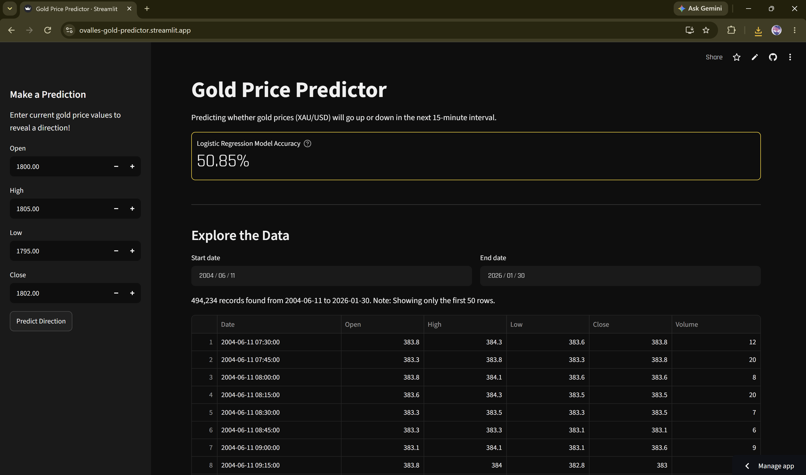

# Gold Price Predictor

A machine learning web app that predicts whether the price of gold (XAU/USD) will go up or down in the next 15-minute interval.

**Live app:** https://ovalles-gold-predictor.streamlit.app

## Overview

Short-term gold traders often review price charts by hand to guess where the market is heading next. That takes time, and the results can change depending on who is looking at the data. This app gives traders a consistent, data-driven signal they can use alongside their own analysis.

The model is a logistic regression classifier trained on more than 494,000 historical 15-minute candles from 2004 to 2026. A trader enters the current candle's open, high, low, and close prices, and the app returns an UP or DOWN prediction for the next candle.

## Features

- **Price direction prediction:** enter current candle prices in the sidebar and get an UP or DOWN prediction
- **Input validation:** catches invalid inputs, like a high price below the low price
- **Data exploration:** filter the historical dataset by date range
- **Visualizations:**
  - Line chart of closing prices over time
  - Histogram of 15-minute returns
  - Confusion matrix showing model performance on the test set
- **Cached data and model:** the data loads and the model trains once, so predictions are fast

## Tech Stack

| Tool | Purpose |
|---|---|
| Python 3.14 | Core language |
| pandas | Data loading and cleaning |
| scikit-learn | Logistic regression model and evaluation |
| Matplotlib | Visualizations |
| Streamlit | Web interface |
| Streamlit Community Cloud | Hosting |

## How It Works

1. **Data cleaning:** missing values and duplicate records are removed
2. **Target variable:** each candle is labeled 1 if the next close is higher and 0 if it is lower
3. **Train/test split:** the data is split 80/20 in time order, so the model is always tested on data that comes after what it learned from
4. **Training:** a logistic regression model is trained on open, high, low, close, and volume
5. **Prediction:** user inputs are passed to the trained model, which returns the predicted direction

## Results

| Metric | Value |
|---|---|
| Test accuracy | 50.85% |
| Test set size | 98,847 candles |
| Always-guess-up baseline | 50.51% |

The model beats random chance and a simple always-guess-up baseline, but only slightly. Short-term gold prices are very noisy, and this model only uses raw price and volume data. I also tested engineered features (candle range and 5- and 20-period moving averages), but they only raised accuracy to 50.96%, so I kept the simpler model.

Possible next steps include adding technical indicators like RSI or momentum, adding outside market data, and trying tree-based models like Random Forest or XGBoost.

## Running Locally

1. Clone the repo:
   git clone https://github.com/rlovalles/gold-price-predictor.git
   cd gold-price-predictor
 
2. Install the requirements:
  pip install -r requirements.txt
  
3. Make sure XAU_15m_data.csv is in the project folder. It can also be downloaded from [Kaggle](https://www.kaggle.com/datasets/novandraanugrah/xauusd-gold-price-historical-data-2004-2024).
4. Run the app:
   streamlit run app.py
 
5. The app opens at http://localhost:8501

## Data Source

[XAU/USD Gold Price Historical Data](https://www.kaggle.com/datasets/novandraanugrah/xauusd-gold-price-historical-data-2004-2024) by novandraanugrah on Kaggle.

## Disclaimer

This project is for educational purposes only and is not financial advice. I built is as my capstone for my final project in college.
